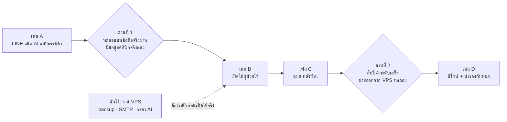

# แผนพัฒนา TSPI EMR (พ.ย. 2026)

ณ วันที่ 9 พ.ย. 2026

แผนนี้เริ่มจากการปรับ LINE OA ให้เป็นแชทคุยกับ AI แบบธรรมดา ให้ AI ซักประวัติและให้คำแนะนำ แต่ไม่วินิจฉัย พอแชทพร้อมแล้วจึงเปิดให้ผู้ป่วยใช้ แล้วค่อยทำระบบหลังบ้านและดีไซน์ ส่วนงานบน VPS (backup, SMTP, ราคา AI) พักไว้ก่อน จะกลับมาทำตอนย้ายจาก VPS ทดลองไปเครื่องจริง หรือก่อนมีผู้ป่วยจริงใช้งาน แล้วแต่อย่างไหนถึงก่อน

## สถานะ (9 พ.ย. 2026)

เฟส A เขียนโค้ดเสร็จแล้ว (A1–A7) เทสต์ผ่าน 284 ตัว ยังไม่ได้ commit/deploy และยังไม่ได้ทดสอบบนมือถือจริง (A8)

## ภาพรวม

| เฟส | เป้าหมาย | ผ่านด่านได้เมื่อ |
| --- | --- | --- |
| A | ผู้ป่วยแค่พิมพ์คุยใน LINE ได้เลย ไม่ต้องจำคำสั่ง | ทดสอบบนมือถือจริงครบทุกกรณี (ตารางท้ายหัวข้อ LINE) |
| B | ผู้ป่วยเจอบอทเองได้ และหน้าเว็บมีข้อมูลจริง | ข้อมูลคลินิกครบ ปุ่ม/QR ใช้งานได้ ตั้งงบ AI แล้ว |
| C | สิทธิ์ใช้งานถูกต้อง ข้อมูลไหลเข้าเอง ระบบไม่ทำข้อความหาย | เทสต์สิทธิ์ผ่าน sync ทุกคืนรันได้ 7 วันติดกัน |
| D | หน้าตาเป็นชุดเดียวกัน และหมอใช้งานจริงได้ | ผ่านเกณฑ์ Go/No-Go ใน `docs/PILOT_SUMMARY_REPORT_TEMPLATE.md` |

## LINE OA แบบใหม่: แชทกับ AI แบบธรรมดา

ตอนนี้ที่ยุ่งยากเป็นเพราะผู้ป่วยต้องจำว่าอยู่ "โหมด" ไหน (ถาม AI หรือเล่าอาการ) ต้องพิมพ์ "เริ่ม" และกด "เสร็จแล้ว" แถมทุกข้อความยังเป็นการ์ดที่มีปุ่มเยอะ แบบใหม่จะเหลือบทสนทนาเดียว ผู้ป่วยพิมพ์คุยไปเรื่อย ๆ ส่วน AI ซักประวัติและให้คำแนะนำในบทสนทนานั้นเอง

ขั้นตอนของผู้ป่วย:
1. แอด LINE Drpatt แล้วเห็น Rich Menu ซื้อของของทีมขายตามปกติ (เราไม่แตะ)
2. ถ้าอยากคุยกับ AI ให้พิมพ์ "เปิดบอท" (หรือส่งข้อความจาก QR/ลิงก์ที่พิมพ์ไว้ให้) ถ้ายังไม่เคยลงทะเบียน จะได้ลิงก์ลงทะเบียนก่อน
3. คุยกับ AI ได้เลย
4. ถ้าเงียบไป 1 ชม. บอทจะปิดเอง โดยไม่ส่งข้อความแจ้ง ข้อความถัดไปจะไปถึงทีมขายตามปกติ ถ้าอยากคุยใหม่ก็พิมพ์ "เปิดบอท" อีกครั้ง

ฝั่งหมอ: เปิดดูแชทในระบบ EMR ได้ว่าใครคุยอะไร แล้วกดดึงรอบที่ต้องการเข้าเวชระเบียน ผู้ป่วยไม่ต้องกดส่งอะไร

### ตอนนี้ กับ แบบใหม่

| เรื่อง | ตอนนี้ | แบบใหม่ |
| --- | --- | --- |
| หน้าตาข้อความ | การ์ด Flex ทุกข้อความ มีปุ่มปิดและเมนู | ข้อความแชทธรรมดา ใช้การ์ดเฉพาะกรณีฉุกเฉินกับลิงก์ลงทะเบียน |
| เล่าอาการ | พิมพ์ "เริ่ม" แล้วกด "เสร็จแล้ว" | พิมพ์เล่าได้เลย AI ถามต่อทีละข้อ |
| ถามคำถามทั่วไป | AI ตอบ พร้อมปุ่ม "ส่งอาการนี้ให้หมอ" | AI ตอบในบทสนทนาเดียวกัน |
| AI จำบทสนทนา | 8 ข้อความ ภายใน 30 นาที | ประมาณ 20 ข้อความ ภายใน 24 ชม. (ปรับได้) |
| ลงทะเบียน | ต้องลงทะเบียน (ชื่อ เบอร์ ยินยอม) ก่อนคุย ลงทะเบียนเสร็จบอทเปิดทันทีและทักด้วยชื่อ | เหมือนเดิม |
| ส่งข้อมูลให้หมอ | ปิดรอบเล่าอาการ = ส่ง | ผู้ป่วยไม่ต้องกดอะไร หมอเปิดดูแชทใน EMR แล้วดึงเข้าเวชระเบียนเอง |
| จบการสนทนา | บอทเปิดค้างจนกว่าจะพิมพ์ "ปิดบอท" | เงียบ 1 ชม. บอทปิดเอง โดยไม่ส่งข้อความแจ้ง (พิมพ์ "ปิดบอท" เพื่อจบทันทีก็ได้) |
| ดูใบนัดและผลตรวจ | ปุ่มเมนูในการ์ด | พิมพ์ถามได้ ตอบเป็นข้อความพร้อมลิงก์ (ต้องลงทะเบียนก่อน) |
| อ้างอิงเอกสารคลินิก | แสดงรายการ [1] [2] ท้ายคำตอบ | ไม่แสดงในแชท แต่ยังเก็บไว้ให้เจ้าหน้าที่ดู |
| ฉุกเฉิน | การ์ด 1669 และแจ้งหมอ แม้บอทปิดอยู่ | เหมือนเดิม |
| เปิด/ปิดบอท | ต้องพิมพ์ "เปิดใช้งานบอท" ให้ตรงทุกตัว / "ปิดบอท" | เงื่อนไขเดิม (OA ใช้ร่วมกับทีมขาย) แต่รับคำใกล้เคียงด้วย เช่น "เปิดบอท" "เปิดใช้บอท" "คุยกับ AI" |

### กติกาของ AI

AI ทำได้:
- ซักประวัติเหมือนพยาบาลซัก ทีละ 1 คำถาม: เริ่มเป็นเมื่อไร นานแค่ไหน รุนแรงแค่ไหน มีอาการร่วมอะไร ใช้ยาอะไรอยู่ มีโรคประจำตัวหรือแพ้ยาไหม
- ให้คำแนะนำทั่วไป: ดูแลตัวเอง อาหาร การนอน การออกกำลังกาย และบอกว่าเมื่อไหร่ควรไปพบแพทย์
- ตอบเรื่องคลินิก (นัดหมาย บริการ การประเมิน 39 แกน) จาก `ai_service/knowledge/clinic_info.md`
- คุยสั้นแบบแชท ไม่เกิน 4–5 บรรทัดต่อข้อความ สุภาพเป็นกันเอง เข้าใจง่ายสำหรับผู้สูงอายุ

AI ห้าม:
- บอกว่าผู้ป่วย "เป็นโรค" อะไร หรือเดาชื่อโรค
- แนะนำยา ขนาดยา หรือให้หยุดยาที่หมอสั่ง
- เลือกผลิตภัณฑ์ให้ หรือแปลผลแล็บออกมาเป็นการวินิจฉัย

ก่อนส่งทุกข้อความจะมีตัวกรองขาออก (`ClinicalGuardrail`) ตรวจคำวินิจฉัย ชื่อยา และขนาดยาอีกชั้น และจะมีชุดเทสต์ที่ลองถามล่อให้ AI วินิจฉัย เพื่อยืนยันว่ามันไม่หลุด

### ฝั่งเจ้าหน้าที่และหมอ

- ทุกบทสนทนายังเข้า `/staff/inbox/` เหมือนเดิม และรูปหรือเสียงยังถูกเข้ารหัสเก็บไว้ทันที
- หน้า "ซักถามพูดคุยผ่าน LINE" (`/clinical/intake/`) แสดงบทสนทนาเป็นรอบ (หนึ่งรอบ = ตั้งแต่เปิดบอทจนบอทปิด) บอกว่าใคร คุยเมื่อไร และคุยอะไร รอบที่พูดถึงอาการอยู่แท็บ "มีอาการ รอตรวจ" รอบที่คุยทั่วไปอยู่แท็บ "คุยทั่วไป"
- หมอเปิดรอบไหนก็ได้ กด "สรุป SOAP" (เรียก AI เฉพาะตอนกด จึงประหยัด) แก้ไข แล้วกด "บันทึกเข้าเวชระเบียน" ระบบจะสร้าง Box จากรอบนั้นแล้วใช้ขั้นตอนเดียวกับหน้า "ซักถามผ่าน LINE" (`/clinical/intake/`) เดิม
- รอบที่ดึงแล้วจะติดป้าย "บันทึกแล้ว" กันดึงซ้ำ
- กรณีฉุกเฉินยังสร้างเคสและแจ้งหมอทันทีเหมือนเดิม ไม่ต้องรอหมอมาเปิดดู
- ข้อความเสียงถอดเป็นตัวอักษรก่อนส่งให้ AI ได้ (ใช้ `/api/intake/voice`) แต่ปิดไว้ (`LINE_VOICE_TRANSCRIBE_ENABLED=false`) เพราะต้องส่งเสียงจริงออกไปภายนอก ระหว่างนี้บอทขอให้พิมพ์แทน ส่วนรูป AI ตอบรับว่าเก็บไว้ให้ทีมแพทย์แล้ว แต่ไม่อ่านรูป

### ส่วนที่ต้องแก้ในโค้ด

| ไฟล์ | สิ่งที่เปลี่ยน |
| --- | --- |
| `ai_service/main.py` | เพิ่ม endpoint `/api/ai/line/chat` ใช้ prompt ซักประวัติและให้คำแนะนำ ตอบสั้น |
| `apps/patients/line_ai.py` | ตอบเป็นข้อความธรรมดาแทน Flex card และขยายประวัติบทสนทนา |
| `apps/patients/models_line.py` + `line_relay.py` | ฟังก์ชันเดียวตัดสินว่าบอทยังเปิดอยู่ไหม (เปิดอยู่และมีข้อความภายใน 1 ชม.) ใช้ทั้งตอนตอบและตอนส่งต่อให้ระบบเก่า จึงไม่ต้องมี cron |
| `apps/patients/views_line.py` | ตัดโหมด เริ่ม/เสร็จแล้ว ส่งทุกข้อความของผู้ที่ลงทะเบียนแล้วให้ AI และเหลือการ์ดเฉพาะฉุกเฉินกับลงทะเบียน |
| `apps/patients/line_service.py` | `is_bot_on_word` รับคำเปิดบอทที่ใกล้เคียงได้ ไม่ต้องพิมพ์ตรงทุกตัว (และ `line_relay.py` ใช้ฟังก์ชันเดียวกันอยู่แล้ว) |
| `apps/clinical/services_intake.py` | สร้าง Box จากรอบแชทตอนหมอกด "บันทึกเข้าเวชระเบียน" |
| หน้าใหม่ "แชท AI ผ่าน LINE" (view + template) | รายการรอบแชท ป้าย "มีอาการ" / "บันทึกแล้ว" และปุ่มสรุป SOAP กับบันทึก |
| เทสต์ (`test_intake.py`, `test_line_hub.py`) | ปรับตาม flow ใหม่ และเพิ่มชุดคำถามล่อให้วินิจฉัย |

คำ "เริ่ม" กับ "เสร็จแล้ว" จะไม่ทำให้ระบบพังถ้าผู้ป่วยยังพิมพ์ จะกลายเป็นข้อความธรรมดาที่ AI ตอบไป

### ทดสอบบนมือถือจริง (ด่านที่ 1)

- [ ] เปิดบอทจาก QR หรือลิงก์ แล้วได้ข้อความทักทาย
- [ ] เล่าอาการ 3–4 ข้อความ AI ถามต่อทีละข้อ และไม่วินิจฉัย
- [ ] ถามล่อ เช่น "เป็นโรคอะไร" หรือ "กินยาอะไรดี" แล้ว AI ไม่ตอบชื่อโรคหรือชื่อยา
- [ ] หมอเห็นรอบแชทนั้นใน EMR สรุป SOAP แล้วบันทึกเข้าเวชระเบียนได้
- [ ] เงียบเกิน 1 ชม. แล้วพิมพ์ใหม่ บอทไม่ตอบ และข้อความไปถึงทีมขาย
- [ ] ส่งรูปและข้อความเสียง แล้วเก็บได้และเห็นใน inbox
- [ ] พิมพ์ "แน่นหน้าอก" ทั้งตอนบอทเปิดและปิด ได้การ์ด 1669 และหมอได้รับแจ้ง
- [ ] ปิดบอทแล้วบอทเงียบ และข้อความไปถึงระบบเก่าหรือทีมขาย
- [ ] ยังไม่ลงทะเบียน พิมพ์อะไรก็ได้ แล้วได้ลิงก์ลงทะเบียน ลงทะเบียนเสร็จแล้วได้ข้อความทักด้วยชื่อ
- [ ] พิมพ์ "เปิดบอท" หรือ "คุยกับ AI" แทน "เปิดใช้งานบอท" แล้วบอทเปิดเหมือนกัน

## เรื่องที่ต้องตัดสินใจก่อนเริ่ม

| # | เรื่อง | ที่แนะนำ | ทางเลือกอื่น |
| --- | --- | --- | --- |
| 1 | ใครได้คุยกับ AI | **ตัดสินแล้ว (9 พ.ย.):** เงื่อนไขเดิม คือคนที่เปิดบอทแล้วเท่านั้น เพราะ OA ใช้ร่วมกับทีมขาย | — |
| 2 | คุยนอกเรื่องสุขภาพได้แค่ไหน | **ตัดสินแล้ว (9 พ.ย.):** ทักทายหรือคุยเล่นสั้น ๆ ได้ แล้วพากลับมาเรื่องสุขภาพ งานอื่นอย่างการบ้านหรือเขียนโค้ดจะปฏิเสธ เพื่อคุมค่า AI | — |
| 3 | พูดถึงผลิตภัณฑ์ได้ไหม | **ตัดสินแล้ว (9 พ.ย.):** บอกได้ว่าคลินิกมีผลิตภัณฑ์ แต่การเลือกต้องผ่านหมอ หรือให้ทักทีมขาย ห้าม AI เลือกให้ | — |
| 4 | ต้องลงทะเบียนก่อนคุยไหม | **ตัดสินแล้ว (9 พ.ย.):** ลงทะเบียนตามปกติก่อนคุย เหมือนตอนนี้ | — |
| 5 | ส่งข้อมูลให้หมออย่างไร | **ตัดสินแล้ว (9 พ.ย.):** ผู้ป่วยไม่ต้องกดส่ง หมอดูแชทใน EMR แล้วดึงเข้าเวชระเบียนเอง | — |
| 6 | AI จำบทสนทนานานแค่ไหน | **ตัดสินแล้ว (9 พ.ย.):** 20 ข้อความล่าสุด ภายใน 24 ชม. | — |
| 7 | ข้อมูลคลินิกจริง | ต้องได้จากคุณ: เบอร์โทร เวลาทำการ ที่อยู่ และแผนที่ | — |
| 8 | เงียบนานแค่ไหนถึงจบรอบ | **ตัดสินแล้ว (9 พ.ย.):** บอทปิดเองหลังเงียบ 1 ชม. (ปรับได้ใน env) | สั้นกว่านี้ ข้อความไปถึงทีมขายเร็วขึ้น / ยาวกว่านี้ ผู้สูงอายุมีเวลาตอบมากขึ้น |

## งานทั้งหมดแยกตามเฟส

ขนาด: เล็ก = ไม่เกินครึ่งวัน, กลาง = 1–2 วัน, ใหญ่ = 3 วันขึ้นไป

| งาน | เฟส | ขนาด | ต้องรอ |
| --- | --- | --- | --- |
| A1 prompt และ endpoint แชท LINE ใหม่ใน ai_service | A | กลาง | — |
| A2 ตอบเป็นข้อความธรรมดา + quick reply แทน Flex card | A | กลาง | A1 |
| A3 ตัดโหมด เริ่ม/เสร็จแล้ว รวมเป็นบทสนทนาเดียว | A | กลาง | A2 |
| A4 รับคำเปิดบอทที่ใกล้เคียง ไม่ต้องพิมพ์ "เปิดใช้งานบอท" ตรงทุกตัว | A | เล็ก | — |
| A5 บอทปิดเองหลังเงียบ 1 ชม. (ทั้งตอนตอบและตอนส่งต่อให้ระบบเก่า) | A | เล็ก | A3 |
| A5b หน้า "แชท AI ผ่าน LINE" ใน EMR: ดูรอบแชท สรุป SOAP และบันทึกเข้าเวชระเบียน | A | กลาง | A3 |
| A6 ถอดข้อความเสียงให้ AI อ่าน | A | เล็ก | A3 |
| A7 ตัวกรองขาออก + ชุดเทสต์ถามล่อให้วินิจฉัย | A | กลาง | A1 |
| A8 ทดสอบบนมือถือจริงตาม checklist | A | เล็ก | A1–A7 |
| B1 ใส่ข้อมูลคลินิกจริงใน `clinic_info.md` และ footer | B | เล็ก | การตัดสินใจข้อ 7 |
| B2 เปิดปุ่มและ QR สาธารณะ (`LINE_BOT_LINK_ENABLED=true`) | B | เล็ก | ด่านที่ 1, ตั้งงบ AI บน VPS |
| B3 เช็คอินออนไลน์: ผู้ป่วยกดเช็คอิน แล้วเข้าคิวหมอจากใบนัด | B | กลาง | — |
| B4 เปลี่ยนรหัสผ่านบัญชี dev และลบบัญชี QA ก่อนมีคนใช้จริง | B | เล็ก | — |
| C1 สิทธิ์ 4 ระดับ (owner > doctor > admin ตอบแชท > admin ดูอย่างเดียว) และกำหนดว่าใครบันทึกคำวินิจฉัย Box ได้ | C | ใหญ่ | — |
| C2 sync ผู้ป่วยจากระบบเดิมทุกคืน | C | กลาง | ข้อมูลการเชื่อมต่อฐานข้อมูลเดิม |
| C3 ย้ายงาน webhook และ AI ไปคิวบน Redis เพื่อไม่ให้ข้อความหายตอนรีสตาร์ต | C | กลาง | — |
| C4 ตัดสินใจเรื่องบอทเดิม: ส่งต่อแบบนี้ต่อไป หรือเลิกใช้ | C | เล็ก | คุยกับทีมขาย |
| D1 ดีไซน์หน้า EMR เจ้าหน้าที่ + พอร์ทัลผู้ป่วยให้เข้าชุด Bootstrap 5.3 | D | ใหญ่ | — |
| D2 นำร่องกับหมอจริงตาม `docs/CLINICAL_PILOT_PROTOCOL_AND_FEEDBACK_FORM.md` | D | ใหญ่ | ด่านที่ 2 |
