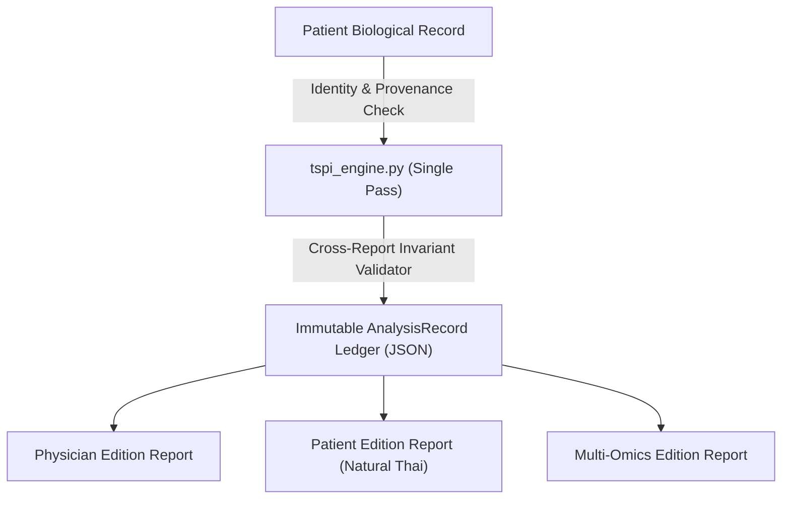

# EP5 — Shared Analysis Record & Final Audit Deliverables (30 Sep 2026)

## ภาพรวมสถาปัตยกรรม (Architecture Audit Overview)
การปรับปรุงแก้ไขระบบ **TSPI Clinical Intelligence Engine** สำเร็จลุล่วงครบถ้วนตามข้อกำหนด **FINAL CORE CORRECTION REQUEST (16 รายการ P0/P1)** โดยยึดหลักสถาปัตยกรรม **Single-Pass Core Engine with Memory Ledger**:

---

## สรุปรายการแก้ไข P0 + P1 ทั้งหมด 16 รายการ

| No. | หัวข้อปรับปรุง | ระดับ | EP | สถานะ | ไฟล์ที่เกี่ยวข้องหลัก |
|---|---|---|---|---|---|
| 1 | Approved Scoring Rule Registry | P0 | EP1 | COMPLETE | `core_contracts.py`, `tspi_engine.py` |
| 2 | แยก A1 (Inflammatory) กับ A2 (Immune) | P0 | EP1 | COMPLETE | `tspi_engine.py` |
| 3 | HYPOTHESIS & CLINICAL_INFERENCE axes `severity_score = null` | P0 | EP1 | COMPLETE | `core_contracts.py`, `tspi_engine.py` |
| 4 | Canonical 12 Domains Lock จาก Master Registry เท่านั้น | P0 | EP2 | COMPLETE | `local_report_generator.py`, `tspi_engine.py` |
| 5 | Canonical Names & Nine Steps ใช้ชื่อเป็นทางการ | P0 | EP2 | COMPLETE | `views_ai.py`, `local_report_generator.py` |
| 6 | แยก `data_availability` จาก `score_status` | P0 | EP1 | COMPLETE | `core_contracts.py` |
| 7 | Decouple Severity จาก Restoration Priority | P0 | EP1 | COMPLETE | `tspi_engine.py` |
| 8 | Restoration Priority Contract: status = DERIVED | P0 | EP1 | COMPLETE | `tspi_engine.py` |
| 9 | Strict Approval State Machine (`AI_DRAFT` → `RELEASED`) | P0 | EP3 | COMPLETE | `models.py`, `views_ai.py` |
| 10 | Patient Renderer ซ่อน Debug Tags ภายใน | P0 | EP3 | COMPLETE | `views_ai.py` |
| 11 | แก้ไขข้อความอนุมัติขัดแย้งใน Patient Report | P0 | EP3 | COMPLETE | `views_ai.py` |
| 12 | Cross-Report Invariant Validator (INV-001..014) | P0 | EP3 | COMPLETE | `tspi_engine.py` |
| 13 | Clinical Utility Gate 12 ข้อสำหรับ Omics ขั้นสูง | P1 | EP4 | COMPLETE | `core_contracts.py`, `tspi_engine.py` |
| 14 | Omics เป็น Resolution Layer ไม่ใช่ Prerequisite | P1 | EP4 | COMPLETE | `tspi_engine.py` |
| 15 | Test Evidence Tiering 4 เกรด | P1 | EP4 | COMPLETE | `core_contracts.py` |
| 16 | Iron Safety Hold Protocol (เจาะจงสารเสริมอาหาร) | P1 | EP4 | COMPLETE | `tspi_engine.py` |

---

## ตารางสรุป Invariants บังคับใช้ (Cross-Report Invariants INV-001..INV-014)

| Invariant ID | รายละเอียดข้อบังคับ | ผลลัพธ์เมื่อขัดแย้ง |
|---|---|---|
| **INV-000** | Demographics Mismatch / Owner HN Mismatch | BLOCKED |
| **INV-001** | HYPOTHESIS axis มี severity_score != null | BUILD_FAIL |
| **INV-002** | HYPOTHESIS axis มี eligible_for_priority = True | BUILD_FAIL |
| **INV-003** | Three Keys status ไม่ใช่ DERIVED หรือ PARTIAL_NOT_SCORABLE | BUILD_FAIL |
| **INV-004** | Nine Restoration Steps ชื่อและลำดับไม่ตรง 1..9 | BUILD_FAIL |
| **INV-005** | Network Registry APPROVED โดยไม่มีการลงนามอนุมัติ | BUILD_FAIL |
| **INV-006** | Module Registry approved count ขัดแย้งกับ registry_status | BUILD_FAIL |
| **INV-007** | Global CONTRAINDICATED (ให้ใช้ intervention_eligibility แทน) | BUILD_FAIL |
| **INV-008** | Canonical 39 Axes รหัส/ชื่อภาษาอังกฤษไม่ตรง Master Registry | BUILD_FAIL |
| **INV-009** | Restoration Registry count != 9 | BUILD_FAIL |
| **INV-010** | Canonical 12 Domains รหัส/ชื่อ/การจับคู่แกนไม่ตรง Master Registry | BUILD_FAIL |
| **INV-011** | CLINICAL_INFERENCE axis มี severity_score != null | BUILD_FAIL |
| **INV-012** | CLINICAL_INFERENCE axis มี eligible_for_priority = True | BUILD_FAIL |
| **INV-013** | รายงานสถานะ AI_DRAFT มีข้อความอ้างว่า "อนุมัติแล้ว" | BUILD_FAIL |
| **INV-014** | `recommended_modules_clinical` ไม่เป็นค่าว่างเมื่อ `approved_modules == 0` | BUILD_FAIL |

---

## ผลการทดสอบ (Verification Summary)
- **Django Unit Tests Suite:** **Ran 66 tests — OK** (ผ่านครบทั้งหมด 66 เคสใน 1.846 วินาที)
- **เอกสารสรุปราย Module (Documentation Suite):**
  - [EP1_numeric_scoring_governance.md](file:///Users/tanchonl/Downloads/drpatt/docs/EP1_numeric_scoring_governance.md)
  - [EP2_master_canonical_ontology.md](file:///Users/tanchonl/Downloads/drpatt/docs/EP2_master_canonical_ontology.md)
  - [EP3_report_approval_and_rendering_governance.md](file:///Users/tanchonl/Downloads/drpatt/docs/EP3_report_approval_and_rendering_governance.md)
  - [EP4_multi_omics_utility_and_iron_safety.md](file:///Users/tanchonl/Downloads/drpatt/docs/EP4_multi_omics_utility_and_iron_safety.md)
  - [EP5_final_audit_deliverables.md](file:///Users/tanchonl/Downloads/drpatt/docs/EP5_final_audit_deliverables.md)
