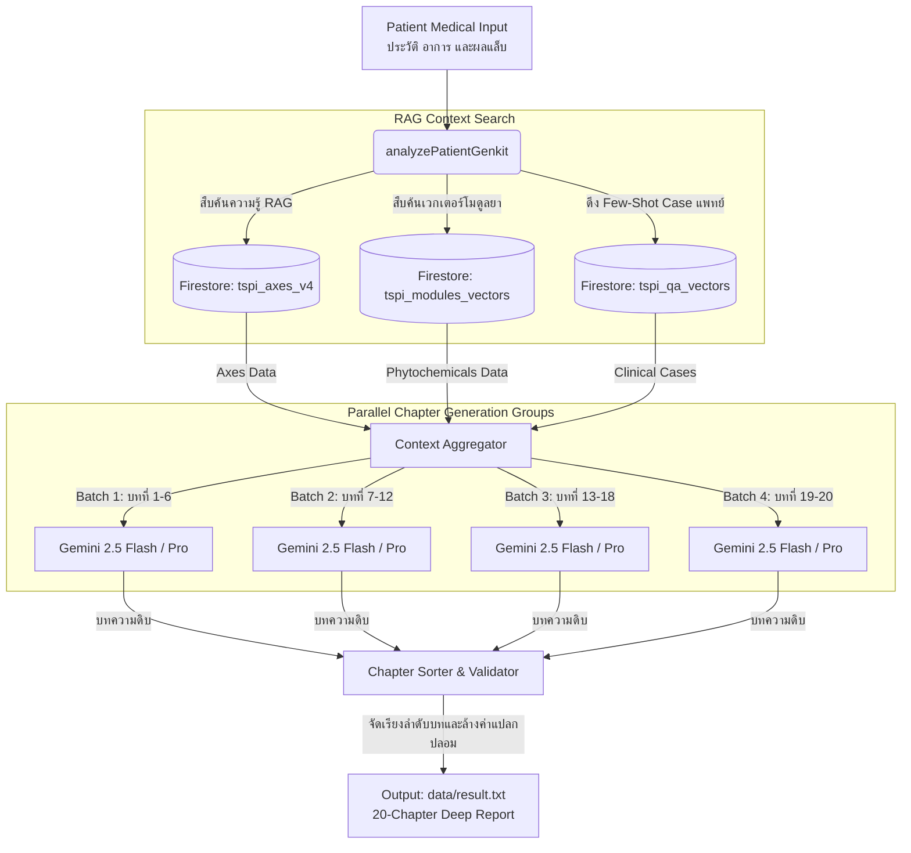

# 📑 เอกสารข้อมูลเชิงลึกและการวิเคราะห์ทางเทคนิค: เฟส 3 — Precision Medicine AI Engine

**หัวข้อโครงการ:** ระบบประมวลผลเครือข่ายชีวภาพอัจฉริยะและการสร้างรายงานแพทย์เชิงระบบ (TSPI Clinical AI Report Generator)  
**เวอร์ชันเอกสาร:** 1.2.0-PROD (เจาะลึกสถาปัตยกรรมเฉพาะเฟส 3)  
**สถานะ:** โครงสร้างหลักประมวลผลเสร็จสิ้น 100% พร้อมขัดเกลามิติข้อมูลวิจัยขั้นสูง 4 เลเยอร์ (4-Layer Framework Optimization)

---

## 🧭 1. บทนำและขอบเขตทางเทคนิคของเฟส 3 (Phase 3 Technical Scope)

ในสัญญางานพัฒนา **เฟส 3 (Precision Medicine AI Engine - กำหนดเวลา 45–50 วัน)** ขอบข่ายหน้าที่หลักคือการสร้างเครื่องยนต์ประมวลผลปัญญาประดิษฐ์ทางการแพทย์ที่รับข้อมูลประวัติคนไข้และผลแล็บมาทำการจัดทำรายงานเชิงลึก (Clinical Report Generation) ที่มีความยาวและระดับรายละเอียดอ้างอิงวิทยาศาสตร์อย่างครบถ้วน

เพื่อตอบสนองต่อแนวคิดการแพทย์เชิงระบบ (Systems Biology) และความต้องการสูงสุดของแพทย์ผู้รักษา ระบบ AI Engine ของเฟส 3 จึงได้รับการวางโครงสร้างและขยายศักยภาพการวิเคราะห์ออกเป็น **4 มิติหลัก (4-Layer Analytics System)** ดังนี้:

```
+-------------------------------------------------------------------------------+
|                        [LAYER 1: 3 KEYS (กุญแจ 3 ดอก)]                          |
|         Metabolic Energy  |  Biological Dynamics  |  Biointegrity             |
+-------------------------------------------------------------------------------+
                                        |
                                        v
+-------------------------------------------------------------------------------+
|                       [LAYER 2: 9 STEPS (บันได 9 ขั้น)]                         |
|   1. Detoxification  2. Microbiome  3. Immune  4. Redox  5. Metabolic/Mito    |
|   6. Autophagy  7. Genomic Stability  8. Genomic Regulation  9. Prakati       |
+-------------------------------------------------------------------------------+
                                        |
                                        v
+-------------------------------------------------------------------------------+
|                     [LAYER 3: 12 DOMAINS HEALTH SCORING]                      |
|       ประเมินระดับความเสียหายของระบบสรีรวิทยาทางคลินิก 12 โดเมนหลัก (คะแนนเต็ม 10)      |
+-------------------------------------------------------------------------------+
                                        |
                                        v
+-------------------------------------------------------------------------------+
|               [LAYER 4: 39 BIOLOGICAL AXES & 180 NETWORKS]                    |
|   - จัดกลุ่มแกนหลัก/รอง (Primary/Secondary/Supporting Axes)                        |
|   - ดึงเฉพาะ 15-25 เครือข่ายชีวภาพที่สัมพันธ์เชิงกลไกเพื่ออธิบายสรีรวิทยาของคนไข้            |
+-------------------------------------------------------------------------------+
```

---

## 🗺️ 2. แผนภาพสถาปัตยกรรม RAG และลูปประมวลผลขนาน (Parallel RAG Architecture)

ระบบ RAG ของเฟส 3 ได้รับการออกแบบใหม่ทั้งหมดเพื่อป้องกันปัญหา **Network Timeout (การหมดเวลาการเชื่อมต่อ)** ที่มักเกิดขึ้นกับการประมวลผลเนื้อหารายงานแพทย์ความยาวกว่า 30 หน้า โดยใช้ระบบแบ่งลูปประมวลผลคู่ขนาน (Parallel Batch Processing Group) ดังภาพ:



---

## 🧬 3. รายละเอียดการทำงานของระบบวิเคราะห์ 4 เลเยอร์ (Detailed 4-Layer Implementation)

### เลเยอร์ที่ 1: การคำนวณตาม 39 แกนชีววิทยา (39 Biological Axes Scoring)
*   **โครงสร้างข้อมูลจริงบน Firestore:** ฐานข้อมูลจัดเก็บในคอลเลกชัน `tspi_axes_v4` จำนวน 37 เอกสารที่ทำงานอยู่จริง (ตัดแกนที่ 37 และ 38 ที่ล้าสมัยออก และเพิ่มแกนที่ 39: Cognitive-Emotional Loop Axis เข้าไป)
*   **การประเมินผล:** AI จะให้คะแนนในระดับ 0 (วิกฤต/มีภาระโรครุนแรง) ถึง 100 (สมบูรณ์ดีเยี่ยม) 

### เลเยอร์ที่ 2: การประเมินตามบันได 9 ขั้นเวอร์ชันล่าสุด (Updated 9-Step Ladder)
เพื่อให้การฟื้นฟูระบบชีวภาพของคนไข้เป็นไปอย่างถูกต้องตามลำดับธรรมชาติ ระบบ AI ในเฟส 3 ได้ปรับเปลี่ยนไปใช้ลำดับขั้นฟื้นฟูเวอร์ชันล่าสุด (ล่าสุด มิใช่โครงสร้างเก่า):
1.  **Detoxification** (การเคลียร์และล้างสารพิษในตับ/ไต/เซลล์)
2.  **Microbiome Ecosystem** (ความยืดหยุ่นของระบบนิเวศและจุลชีพในลำไส้)
3.  **Immune-Inflammatory Regulation** (การปรับสมดุลภูมิคุ้มกันและยุติการอักเสบเรื้อรัง)
4.  **Redox Homeostasis & Oxidative Balance** (การควบคุมภาวะเครียดออกซิเดชัน)
5.  **Enhance Metabolic Function & Mitochondria** (การเพิ่มประสิทธิภาพเมตาบอลิซึมและการผลิต ATP)
6.  **Autophagy & Cellular Clearance** (การทำความสะอาดและรีไซเคิลของเสียภายในเซลล์)
7.  **Genomic Stability & Proteostasis** (การซ่อมแซม DNA และการควบคุมพับโปรตีน)
8.  **Genomic Regulation Homeostasis** (การควบคุมอีพิเจเนติกส์และการแสดงออกของยีน)
9.  **Prakati** (ปกติสภาวะ / สมดุลชีวิตองค์รวมพร้อมรับมือสิ่งรบกวน)

### เลเยอร์ที่ 3: ตารางคะแนนความเสียหาย 12 โดเมน (12 Domains Score Table)
ระบบ AI จะทำการสรุปสรีรวิทยารายโดเมนและประเมินระดับความเสียหายของแต่ละโดเมนออกมาเป็นคะแนนเต็ม 10 คะแนน นำมาสรุปเป็นตาราง Markdown ในบทแรกเพื่อให้แพทย์มองเห็นภาพรวมของปัญหารวดเร็วที่สุด เช่น:
*   *Energy & Metabolism:* 9/10 (ระดับความเสียหายรุนแรงมาก)
*   *Vascular & Microcirculation:* 9/10 (ระดับความเสียหายรุนแรงมาก)
*   *Neuro-Muscular:* 8/10 (ความเสียหายระดับสูง)
*   *Oxidative Stress:* 8/10 (ความเสียหายระดับสูง)
*   *Microbiome & Barrier:* 7/10 (ความเสียหายระดับปานกลางค่อนสูง)
*   *Detoxification:* 7/10 (ความเสียหายระดับปานกลางค่อนสูง)

### เลเยอร์ที่ 4: เครือข่ายชีวภาพ 180 เครือข่าย (180 Living Biological Networks Integration)
ภายใต้แกนหลัก 39 แกน จะมีเครือข่ายชีวภาพรวมทั้งระบบ 180 เครือข่าย เพื่อไม่ให้รายงานมีความซับซ้อนเกินไปสำหรับคนไข้และแพทย์ AI ในเฟส 3 จะคัดสรรและแสดงเฉพาะ **15-25 เครือข่ายชีวภาพที่เสียหายและสัมพันธ์กับคนไข้รายนั้นที่สุด** เช่นในเคสผู้ป่วยเบาหวานและมีอาการบวมคั่งที่ขา:
*   *Glucose Utilization Network & Insulin Signaling Network* (การใช้กลูโคสและตอบสนองต่ออินซูลิน)
*   *AGE Formation Network & Protein Crosslinking Network* (การจับตัวของน้ำตาลกับโปรตีนในหลอดเลือดและปลอกประสาท)
*   *Endothelial Integrity & Microcirculation Network* (เยื่อบุหลอดเลือดและหลอดเลือดฝอยส่วนปลาย)
*   *Venous/Lymphatic Clearance Network* (การระบายและไหลกลับของน้ำเหลืองและเลือดดำ)
*   *Peripheral Nerve Integrity Network* (ความสมบูรณ์และเสื่อมถอยของระบบประสาทปลายเท้า)
*   *Autophagy Flux & Proteostasis Network* (ระบบขจัดขยะโปรตีนเสียหายภายในเซลล์)

---

## 🗂️ 4. สรุปโครงสร้างสารบัญรายงานแพทย์ฉบับเต็ม 20 บท (20-Chapter Agenda)

ในระบบที่สมบูรณ์ รายงานแพทย์วิเคราะห์เชิงระบบได้รับการกำหนดรูปแบบและทิศทางผ่าน [clinicalReportChapters.ts](file:///d:/Pr/dr_pat/functions/src/prompts/clinicalReportChapters.ts) ออกเป็น 20 บทหลักดังนี้:

| บทที่ (Chapter) | ชื่อบทความ (Chapter Title) | วัตถุประสงค์การวิเคราะห์ทางคลินิก (Clinical Objective) |
| :---: | :--- | :--- |
| **1** | Executive Clinical Synopsis and Systems Overview | สรุปประเด็นหลัก ตารางคะแนน 12 โดเมน โครงสร้างโมดูลบำบัดเบื้องต้น |
| **2** | Patient Baseline, Context, and Clinical History | ประวัติพื้นฐาน วิถีชีวิต ยาแผนปัจจุบันที่ใช้ และวิถีการดำเนินของโรค |
| **3** | Symptom Intelligence and Functional Pattern Recognition | จัดกลุ่มอาการแสดงออกเป็นรูปแบบกลุ่มอาการเชิงหน้าที่ เชื่อมโยงหาต้นตอ |
| **4** | Drug, Treatment, and Exposure Burden Analysis | ประเมินผลกระทบและภาระเคมีจากยารักษาปัจจุบัน สิ่งแวดล้อม และวิถีชีวิต |
| **5** | Clinical Laboratory Systems Analysis | วิเคราะห์ผลตรวจแล็บ วิถีเมตาบอลิซึม ความเครียดอวัยวะ และการอักเสบ |
| **6** | Genomic, Exome, and Pharmacogenomic Interpretation | แปลความเสี่ยงพันธุกรรม SNP ยีนกำจัดสารพิษ และผลตอบสนองของยา |
| **7** | Gut Microbiome Ecology and Host-Microbe Interaction | ประเมินความหลากหลายของจุลชีพในลำไส้ การรั่วไหล และผลต่อภูมิคุ้มกัน |
| **8** | Proteomics and Metabolomics Interpretation | วิเคราะห์ข้อมูลโปรตีน สารเมตาโบไลต์จากการตรวจด้วยเครื่อง LC-MS |
| **9** | Mitochondrial Function, Energy Failure, and Cellular Stress | ประเมินอัตราผลิตพลังงาน ATP ในไมโทคอนเดรีย และความเครียดระดับเซลล์ |
| **10** | Inflammation, Immune Dysregulation, and Oxidative Stress Network | เชื่อมโยงวงจรอักเสบ ภาระไซโตไคน์ และอนุมูลอิสระที่เป็นตัวเร่งโรค |
| **11** | Detoxification, Autophagy, and Biological Waste Clearance | วิเคราะห์ระบบระบายของเสียและการกำจัดขยะโปรตีนเสื่อม (Autophagy) |
| **12** | DNA Protection, Repair Capacity, and Gene Regulation Balance | การปกป้อง DNA ความยืดหยุ่นในการซ่อมแซม และความสมดุลการแสดงออกของยีน |
| **13** | Structural, Functional, and Organ-System Reserve Assessment | ประเมินระบบกล้ามเนื้อ ข้อต่อ โครงสร้างกระดูก และการสำรองพลังงานอวัยวะ |
| **14** | Mapping Across the 39 Biological Axes | จัดกลุ่มแกนชีววิทยาหลัก/รอง/สนับสนุน พร้อมระบุ 15-25 Biological Networks |
| **15** | Nine-Step Ladder Positioning and Systems Restoration Sequence | จัดตำแหน่งคนไข้ลงบนบันได 9 ขั้นปัจจุบัน และกำหนดลำดับขั้นการเยียวยา |
| **16** | TSPI Module Strategy and Precision Module Matching | แนะนำตำรับสมุนไพรรักษา (Primary, Secondary, Supporting) พร้อมกลไก |
| **17** | Therapeutic Roadmap, Monitoring Plan, and Reassessment Strategy | แผนภูมิการจัดส่งยา การดูแลคนไข้ และตัวชี้วัดความคืบหน้าของการฟื้นฟู |
| **18** | Lifestyle Prescription for Biological Restoration | ใบสั่งวิถีชีวิต: รูปแบบการนอน การออกกำลังกาย 6 สัตว์ โภชนาการ และการฝึกประสาท |
| **19** | Clinical Conclusion and Executive Summary | สรุปผลสุดท้ายของการฟื้นฟูร่างกาย คาดการณ์ขีดจำกัดสูงสุด และเป้าหมาย |
| **20** | Monitoring Program and Reassessment Protocol | แผนกำหนดนัดพบแพทย์ทุก 3 เดือน พร้อมรายการเช็คระดับเลือด แล็บ และไมโครไบโอม |

---

## 🔬 5. การพิสูจน์ผลลัพธ์การทำงาน (Proof of Concept Validation)

ผลลัพธ์ของฟังก์ชันในเฟส 3 ได้ผ่านการทดสอบรันด้วยข้อมูลคนไข้จริงของคุณสีมาพร (เบาหวานเรื้อรังควบคุมไม่ได้ร่วมกับแผลเลือดคั่ง stasis dermatitis) โดยผลลัพธ์ได้รับการบันทึกและตรวจสอบแล้วดังนี้:
*   **พิกัดไฟล์ผลลัพธ์รายงานจริง:** [result.txt](file:///d:/Pr/dr_pat/data/result.txt) (ขนาด **196.6 KB**)
*   **เวลาประมวลผล:** **161.0 วินาที** (ผ่านการประมวลผลคู่ขนานแบบไม่ติด Rate Limit ของ API)
*   **ลักษณะทางภาษา:** อธิบายชีวกลไกเชิงระบบลึกและตรรกะทางการแพทย์ที่เหมาะสมกับแพทย์เฉพาะทาง (ภาษาไทยทางการแพทย์ 100%)

*เอกสารรายละเอียดเฟส 3 นี้ พร้อมสำหรับใช้อ้างอิงทางเทคนิคในการประเมินและทบทวนความก้าวหน้าโครงการเพื่อการส่งมอบและการเบิกจ่ายเงินในขั้นตอนต่อไป*
